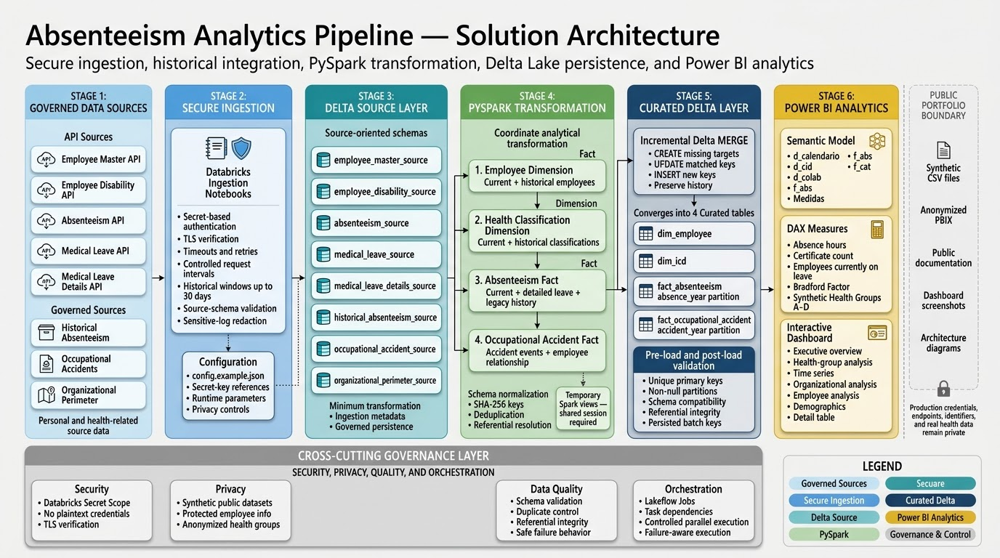
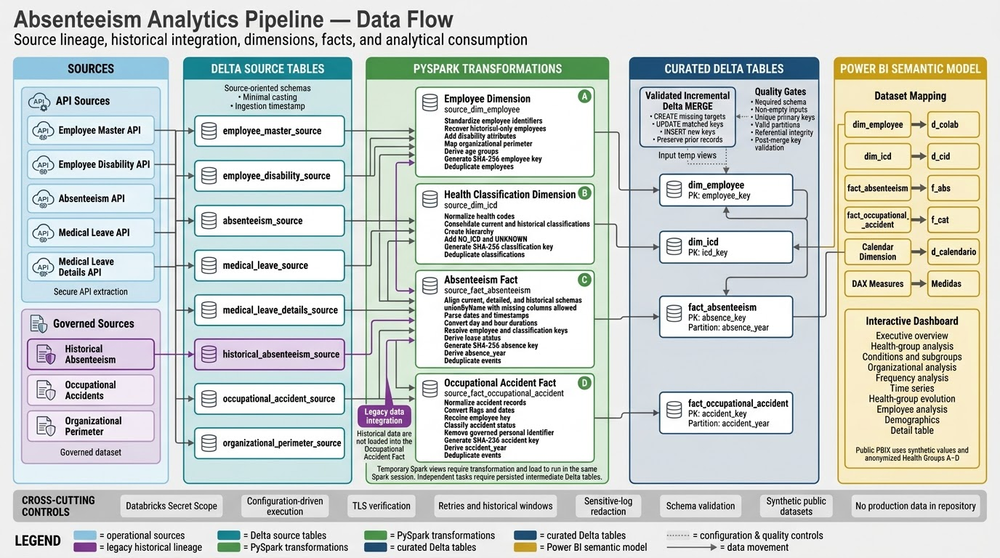
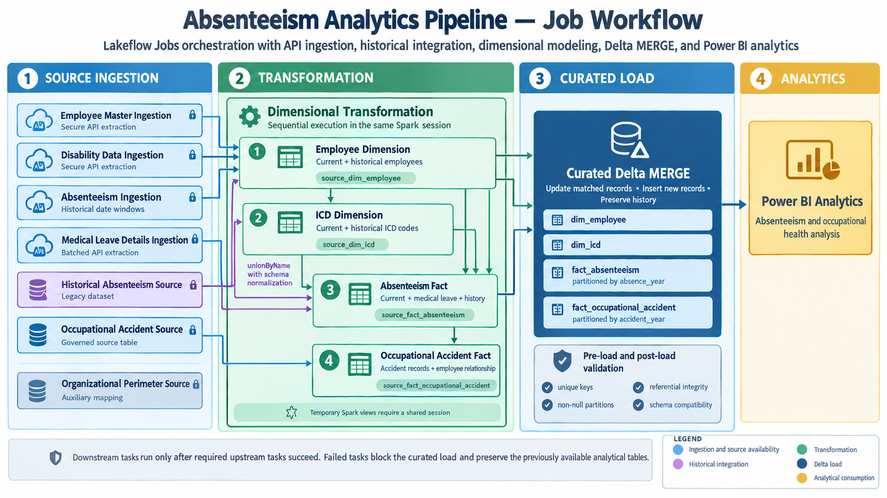

# 🩺 Absenteeism Analytics Pipeline

End-to-end data engineering and business intelligence project for governed absenteeism and occupational-health analytics.

The solution integrates controlled APIs and historical datasets, standardizes heterogeneous records with PySpark, persists curated dimensions and facts in Delta Lake, orchestrates dependencies with Databricks workflows, and delivers an interactive Power BI analytical model.

> This public repository contains synthetic data and sanitized technical assets only. It does not contain production credentials, real employee records, real organizational structures, or the original monitored health classifications.

---

## Project overview

Occupational-health and absenteeism data frequently arrive from multiple systems with different identifiers, schemas, date formats, duration conventions, and update cycles. Historical records may also contain employees or classifications that no longer appear in current sources.

This project addresses that fragmentation through a documented analytical pipeline that:

- extracts controlled operational data;
- preserves source-oriented Delta tables;
- integrates current and historical records;
- builds conformed employee and health-classification dimensions;
- builds absenteeism and occupational-accident facts;
- validates schemas, keys, partitions, and relationships;
- performs incremental curated loads with Delta `MERGE`;
- exposes a reusable Power BI semantic model;
- publishes only synthetic and anonymized portfolio assets.

---

## Dashboard preview


The public dashboard contains 12 analytical pages covering:

- executive indicators;
- anonymized health-group analysis;
- conditions and subgroups;
- organizational distribution;
- frequency and time-series analysis;
- monitored-group evolution;
- employee-level patterns;
- demographic analysis;
- detailed record validation.

Additional screenshots are available in [`screenshots/`](screenshots/README.md).

---

## Solution architecture



The architecture separates source ingestion, analytical transformation, curated persistence, orchestration, semantic modeling, and public portfolio publication.

```text
Governed APIs and historical sources
                |
                v
Databricks ingestion notebooks
                |
                v
Delta source tables
                |
                v
PySpark transformation notebooks
                |
                v
Temporary curated views
                |
                v
Incremental Delta MERGE
                |
                v
Dimensions and fact tables
                |
                v
Power BI semantic model
                |
                v
Interactive analytical dashboard
```

See [`architecture/README.md`](architecture/README.md) for the full architectural rationale.

---

## End-to-end data flow



The pipeline integrates multiple current and governed sources:

```text
Employee Master API
Employee Disability API
Absenteeism API
Medical Leave API
Medical Leave Details API
Historical Absenteeism Source
Occupational Accident Source
Organizational Perimeter Source
```

These sources feed four analytical outputs:

```text
dim_employee
dim_icd
fact_absenteeism
fact_occupational_accident
```

Historical absenteeism contributes to:

- employees found only in legacy records;
- health classifications found only in historical data;
- legacy absence events in the unified absenteeism fact.

---

## Technology stack

### Data engineering

- Python
- PySpark
- Databricks Source notebooks
- Delta Lake
- Databricks Secret Scope
- Lakeflow Jobs / Databricks Workflows

### Analytics and visualization

- Power BI
- Power Query
- DAX
- Dimensional modeling

### Documentation and versioning

- Git and GitHub
- Markdown
- JSON configuration
- Synthetic CSV datasets

---

## Repository structure

```text
absenteeism-analytics-pipeline/
├── README.md
├── LICENSE
├── .gitignore
│
├── architecture/
│   ├── README.md
│   ├── solution-architecture.png
│   └── data-flow.png
│
├── config/
│   ├── README.md
│   └── config.example.json
│
├── data/
│   ├── README.md
│   ├── sample/
│   │   ├── employee_master_sample.csv
│   │   ├── employee_disability_sample.csv
│   │   ├── absenteeism_sample.csv
│   │   ├── medical_leave_details_sample.csv
│   │   ├── historical_absenteeism_sample.csv
│   │   ├── occupational_accident_sample.csv
│   │   └── organizational_perimeter_sample.csv
│   └── schemas/
│       └── data-dictionary.md
│
├── docs/
│   ├── business-context.md
│   ├── technical-decisions.md
│   ├── data-privacy.md
│   └── limitations.md
│
├── notebooks/
│   ├── README.md
│   ├── 01_ingestion/
│   │   ├── README.md
│   │   ├── 01_employee_master_ingestion.py
│   │   ├── 02_disability_ingestion.py
│   │   ├── 03_absenteeism_ingestion.py
│   │   ├── 04_medical_leave_ingestion.py
│   │   └── 05_leave_details_ingestion.py
│   ├── 02_transformation/
│   │   ├── README.md
│   │   ├── 01_employee_dimension.py
│   │   ├── 02_icd_dimension.py
│   │   ├── 03_absenteeism_fact.py
│   │   └── 04_accident_fact.py
│   └── 03_load/
│       ├── README.md
│       └── 01_curated_delta_load.py
│
├── orchestration/
│   ├── README.md
│   └── job-workflow.png
│
├── power-bi/
│   ├── README.md
│   ├── dashboard-pages.md
│   ├── measures.md
│   ├── data-model.md
│   ├── absenteeism-analytics.pbix
│   └── mock-data/
│       ├── README.md
│       ├── d_calendario.csv
│       ├── d_cid.csv
│       ├── d_colab.csv
│       ├── f_abs.csv
│       └── f_cat.csv
│
└── screenshots/
    ├── README.md
    ├── 01-overview.png
    ├── 02-icd-analysis.png
    ├── 03-disease-subgroup.png
    ├── 04-location-analysis.png
    ├── 05-frequency-analysis.png
    ├── 06-time-series.png
    ├── 07-health-group-evolution.png
    ├── 08-hours-evolution.png
    ├── 09-certificates-evolution.png
    ├── 10-employee-analysis.png
    ├── 11-demographics.png
    ├── 12-detail-table.png
    └── 13-data-model.png
```

---

## Pipeline layers

### 1. Ingestion

The ingestion notebooks retrieve controlled source data and persist source-oriented Delta tables.

Key capabilities:

- secret-based authentication;
- TLS and SSL verification;
- timeouts and retries;
- controlled request intervals;
- historical windows of up to 30 days;
- source-schema validation;
- ingestion metadata;
- protected logging.

Source tables include:

```text
employee_master_source
employee_disability_source
absenteeism_source
medical_leave_source
medical_leave_details_source
historical_absenteeism_source
occupational_accident_source
organizational_perimeter_source
```

See [`notebooks/01_ingestion/README.md`](notebooks/01_ingestion/README.md).

### 2. Transformation

The transformation notebooks standardize and integrate current and historical datasets.

Key capabilities:

- Unicode-aware column normalization;
- flexible date and timestamp parsing;
- current and historical integration with `unionByName`;
- duration standardization;
- deterministic SHA-256 analytical keys;
- employee and health-classification resolution;
- deduplication;
- preparation of dimension and fact views.

Temporary outputs:

```text
source_dim_employee
source_dim_icd
source_fact_absenteeism
source_fact_occupational_accident
```

See [`notebooks/02_transformation/README.md`](notebooks/02_transformation/README.md).

### 3. Curated load

The load notebook validates and persists all curated tables.

```text
Target does not exist -> CREATE
Target already exists -> MERGE
```

The incremental load:

- updates matched keys;
- inserts new keys;
- preserves target records absent from the current batch;
- performs no automatic hard delete;
- validates referential integrity and batch persistence.

See [`notebooks/03_load/README.md`](notebooks/03_load/README.md).

---

## Orchestration



The logical workflow is:

```text
1. Source ingestion and governed source availability
2. Employee dimension
3. Health-classification dimension
4. Absenteeism fact
5. Occupational-accident fact
6. Curated Delta MERGE
7. Power BI analytical consumption
```

Independent ingestion tasks may execute in parallel. The current transformation and load notebooks exchange temporary Spark views, so they must execute sequentially in the same Spark session.

See [`orchestration/README.md`](orchestration/README.md).

---

## Curated data model

The engineering layer produces:

```text
dim_employee
dim_icd
fact_absenteeism
fact_occupational_accident
```

Primary analytical relationships:

```text
fact_absenteeism[employee_key]
    -> dim_employee[employee_key]

fact_absenteeism[icd_key]
    -> dim_icd[icd_key]

fact_occupational_accident[employee_key]
    -> dim_employee[employee_key]
```

Fact tables are partitioned by year:

```text
fact_absenteeism             -> absence_year
fact_occupational_accident   -> accident_year
```

The complete field-level reference is available in [`data/schemas/data-dictionary.md`](data/schemas/data-dictionary.md).

---

## Power BI semantic model


The public PBIX retains its existing semantic-model table names:

```text
d_calendario
d_cid
d_colab
f_abs
f_cat
Medidas
```

Mapping to the public engineering model:

| Engineering model | Power BI model |
|---|---|
| `dim_employee` | `d_colab` |
| `dim_icd` | `d_cid` |
| `fact_absenteeism` | `f_abs` |
| `fact_occupational_accident` | `f_cat` |
| Semantic calendar | `d_calendario` |
| DAX measure container | `Medidas` |

The Power BI documentation includes:

- [`power-bi/README.md`](power-bi/README.md)
- [`power-bi/dashboard-pages.md`](power-bi/dashboard-pages.md)
- [`power-bi/measures.md`](power-bi/measures.md)
- [`power-bi/data-model.md`](power-bi/data-model.md)

---

## Main DAX measures

```text
Afastados Hoje
Número de Atestados
Total de Horas de Afastamento
Fator de Bradford
Última Atualização do Pipeline
Grupo A | Atestados
Grupo A | Horas
Grupo B | Atestados
Grupo B | Horas
Grupo C | Atestados
Grupo C | Horas
Grupo D | Atestados
Grupo D | Horas
```

Count and total measures use zero-safe behavior so report cards return `0` instead of blank values when the current context has no records.

The monitored-group measures filter synthetic keys rather than original clinical classifications.

---

## Synthetic datasets

The repository intentionally separates two types of synthetic data.

### Engineering samples

```text
data/sample/
```

These files reproduce source-compatible schemas for pipeline documentation and transformation examples.

### Power BI mock data

```text
power-bi/mock-data/
```

These files reproduce the final semantic-model tables required by the PBIX.

The mock model contains:

```text
d_calendario   1,096 rows
d_cid             10 rows
d_colab           36 rows
f_abs            180 rows
f_cat             30 rows
```

---

## Data privacy and anonymization

The original solution domain includes personal, employment, disability, medical-leave, diagnosis, and occupational-accident information. The public repository therefore applies a strict synthetic-data strategy.

Public assets use values such as:

```text
Employee 01
RH0001
EMP0001
Unit A
Area A
Perimeter A
Role A
Health Group A
Condition A.1
```

The public report does not retain the original monitored health chapters, categories, codes, or descriptions.

Public groups are:

```text
Health Group A
Health Group B
Health Group C
Health Group D
Other Health Groups
Not Reported
```

The private mapping between these groups and the original monitored classifications is excluded from data, DAX, screenshots, metadata, documentation, hidden pages, tooltips, drill-through pages, and repository history.

See [`docs/data-privacy.md`](docs/data-privacy.md).

---

## Public configuration

The public template is stored in:

```text
config/config.example.json
```

It defines:

- generic project settings;
- secret-key references;
- shared API behavior;
- extraction settings;
- Delta storage options;
- source and curated table names;
- data-quality controls;
- privacy controls.

Required safeguards include:

```text
allow_plaintext_secrets = false
publish_real_data = false
use_synthetic_data_in_repository = true
redact_sensitive_logs = true
verify_ssl = true
```

See [`config/README.md`](config/README.md).

---

## Data-quality controls

The project applies controls across the pipeline.

### Ingestion

- mandatory configuration and secrets;
- HTTP status validation;
- retries and timeouts;
- bounded historical windows;
- required source fields;
- safe logging.

### Transformation

- source availability;
- normalized-name collision detection;
- required identifiers and dates;
- non-negative durations;
- deterministic keys;
- deduplication;
- valid partition years.

### Curated load

- required views and columns;
- non-empty datasets;
- non-null and unique primary keys;
- schema compatibility;
- partition integrity;
- employee and health referential integrity;
- post-merge persistence checks.

---

## Running the project

### Prerequisites

- a Databricks environment with PySpark and Delta Lake;
- a configured secret scope;
- access to governed source systems or schema-compatible synthetic source tables;
- permissions to use the configured catalog and schema;
- Power BI Desktop for the public report.

### Configuration

1. Keep `config/config.example.json` as the public template.
2. Create a private environment-specific copy when required.
3. Configure the required secret keys outside the repository.
4. Set safe catalog, schema, and historical-date values in the private configuration.

### Execution order

```text
1. Run or load required source datasets
2. Run ingestion notebooks
3. Run 01_employee_dimension.py
4. Run 02_icd_dimension.py
5. Run 03_absenteeism_fact.py
6. Run 04_accident_fact.py
7. Run 01_curated_delta_load.py
8. Refresh the Power BI analytical model
```

Steps 3 through 7 must currently share the same Spark session.

---

## Public PBIX

The repository may include:

```text
power-bi/absenteeism-analytics.pbix
```

Only the fully sanitized version should be published. The public report must use the synthetic CSV files under `power-bi/mock-data/`.

The public PBIX was reviewed for:

- imported data;
- Power Query parameters and paths;
- monitored-group measures;
- hidden pages;
- tooltips and drill-through pages;
- report, page, and visual filters;
- bookmarks and selections;
- credentials and permissions;
- file metadata;
- screenshot consistency.

---

## Documentation guide

| Topic | Document |
|---|---|
| Business problem and analytical purpose | [`docs/business-context.md`](docs/business-context.md) |
| Architecture | [`architecture/README.md`](architecture/README.md) |
| Technical decisions | [`docs/technical-decisions.md`](docs/technical-decisions.md) |
| Configuration | [`config/README.md`](config/README.md) |
| Notebook layers | [`notebooks/README.md`](notebooks/README.md) |
| Data samples and schemas | [`data/README.md`](data/README.md) |
| Data dictionary | [`data/schemas/data-dictionary.md`](data/schemas/data-dictionary.md) |
| Orchestration | [`orchestration/README.md`](orchestration/README.md) |
| Power BI assets | [`power-bi/README.md`](power-bi/README.md) |
| Dashboard pages | [`power-bi/dashboard-pages.md`](power-bi/dashboard-pages.md) |
| DAX measures | [`power-bi/measures.md`](power-bi/measures.md) |
| Semantic model | [`power-bi/data-model.md`](power-bi/data-model.md) |
| Privacy controls | [`docs/data-privacy.md`](docs/data-privacy.md) |
| Limitations | [`docs/limitations.md`](docs/limitations.md) |
| Screenshot catalog | [`screenshots/README.md`](screenshots/README.md) |

---

## Current limitations

- Public datasets are synthetic and not statistically representative.
- The pipeline requires private source access for production execution.
- Transformation and load currently depend on a shared Spark session.
- No automatic hard delete is implemented in curated targets.
- The eight-hour workday conversion is an analytical convention.
- The public PBIX preserves documented non-ideal model cardinalities.
- The calendar currently covers 2024 through 2026.
- The Bradford Factor must not be interpreted as a clinical or employment decision rule.
- Infrastructure provisioning and deployment automation are outside the repository scope.

See [`docs/limitations.md`](docs/limitations.md) for the complete list.

---

## Intended use

This repository is appropriate for:

- portfolio review;
- data-engineering demonstration;
- architecture discussion;
- PySpark and Delta Lake examples;
- Power BI documentation;
- synthetic testing;
- repository-structure reference.

It is not intended for:

- clinical assessment;
- employee evaluation;
- payroll calculation;
- disciplinary or legal decisions;
- direct production deployment without technical and governance review;
- interpretation of synthetic values as real organizational evidence.

---

## Notice

Synthetic datasets, mock classifications, and public screenshots are provided exclusively for demonstration and documentation purposes.

