# Dashboard Pages

## Overview

The **Absenteeism Analytics Dashboard** contains 12 analytical pages designed to support executive monitoring, health-group analysis, temporal investigation, organizational comparisons, employee-level review, and record-level validation.

The public report is connected exclusively to synthetic mock datasets. Employee names, registrations, organizational structures, health classifications, condition descriptions, and monitored health groups have been anonymized.

> The screenshots referenced in this document represent the public mock report and do not contain production data.

---

## Global navigation and filters

The dashboard uses a consistent navigation bar across the report pages:

```text
Resumo 2026
CID-10
Doença e Subgrupo
Local
Frequência
Série Temporal
Evolução CID
Evolução Horas
Evolução Atestados
Colaborador
Demográfico
Tabela
```

The report also provides shared filters for:

- gender;
- unit;
- month;
- duration type;
- disability classification;
- leave type;
- year;
- perimeter;
- leave status.

The mock dataset uses generic organizational values such as:

```text
Unit A
Unit B
Unit C
Unit D
Unit E

Perimeter A
Perimeter B
Perimeter C
Perimeter D
```

Some perimeter labels may appear visually truncated because the original report layout was designed for fewer perimeter values. This does not affect filtering behavior or analytical results.

---

# 1. Overview


## Purpose

The Overview page provides an executive summary of absenteeism indicators for the selected reporting period.

## Main indicators and visuals

- total absence hours by unit;
- number of medical certificates by unit;
- total absence hours and certificate count over time;
- total absence hours by generic job role;
- number of medical certificates by generic job role;
- absence hours and certificate count by anonymized health group;
- employees currently on leave;
- latest pipeline update timestamp.

## Analytical use

This page supports a quick assessment of:

- which anonymized units concentrate the highest absence volume;
- whether absence hours and certificate counts follow the same pattern;
- which generic roles show higher absence totals;
- how monitored public health groups contribute to the selected period;
- whether any employee is currently classified as on leave.

The `Afastados hoje` card displays `0` rather than a blank value when no active leave is found.

---

# 2. ICD Analysis

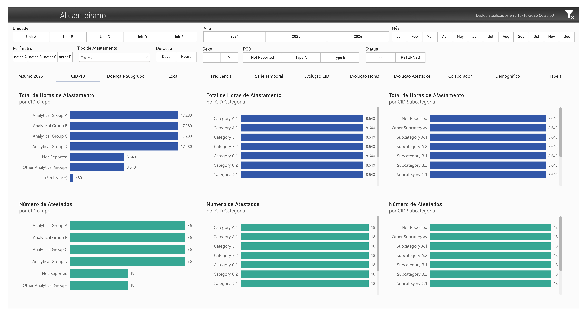

## Purpose

The ICD Analysis page presents a hierarchical view of the anonymized health classification model.

## Main visuals

### Absence hours

- total absence hours by analytical health group;
- total absence hours by category;
- total absence hours by subcategory.

### Medical certificate count

- number of certificates by analytical health group;
- number of certificates by category;
- number of certificates by subcategory.

## Public hierarchy

The public PBIX does not retain real ICD chapters or descriptions. The hierarchy uses synthetic values such as:

```text
Health Group A
Analytical Group A
Category A.1
Subcategory A.1
```

Additional members include:

```text
Other Health Groups
Other Analytical Groups
Not Reported
```

## Analytical use

This page demonstrates hierarchical navigation and comparison without exposing which clinical chapters are monitored in the production solution.

---

# 3. Condition and Subgroup

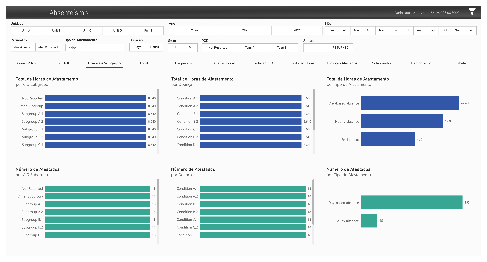

## Purpose

This page provides a more detailed comparison of synthetic conditions, analytical subgroups, and absence types.

## Main visuals

### Absence hours

- total absence hours by synthetic health subgroup;
- total absence hours by generic condition;
- total absence hours by leave type.

### Medical certificate count

- number of certificates by synthetic health subgroup;
- number of certificates by generic condition;
- number of certificates by leave type.

## Public labels

The page uses generic condition labels such as:

```text
Condition A.1
Condition A.2
Condition B.1
Condition B.2
Other condition
Not reported
```

The leave-type comparison separates examples such as:

```text
Day-based absence
Hourly absence
```

## Analytical use

The page helps compare whether a group generates:

- many short records;
- fewer records with longer durations;
- predominantly day-based absences;
- predominantly hourly absences.

---

# 4. Location Analysis

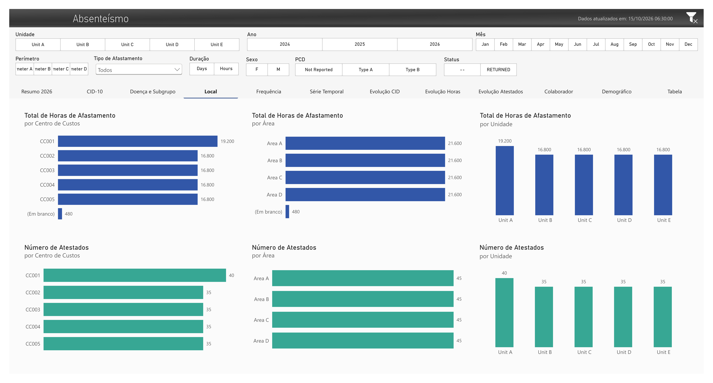

## Purpose

The Location Analysis page compares absence indicators across the anonymized organizational structure.

## Main visuals

### Absence hours

- total absence hours by cost center;
- total absence hours by area;
- total absence hours by unit.

### Medical certificate count

- number of certificates by cost center;
- number of certificates by area;
- number of certificates by unit.

## Public organizational values

```text
CC001 to CC005
Area A to Area D
Unit A to Unit E
```

## Analytical use

This page supports comparisons between organizational groupings while preserving the structure required by the semantic model and removing real location names.

---

# 5. Frequency Analysis

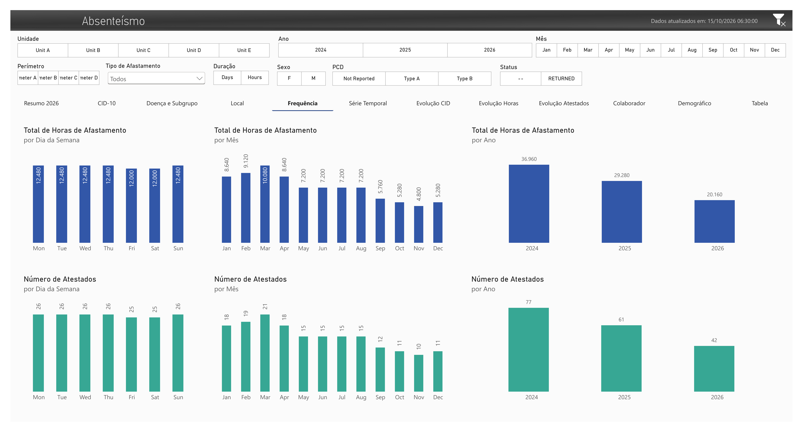

## Purpose

The Frequency Analysis page identifies recurring temporal patterns in absence hours and certificate counts.

## Main visuals

### Absence hours

- total hours by day of the week;
- total hours by month;
- total hours by year.

### Medical certificate count

- number of certificates by day of the week;
- number of certificates by month;
- number of certificates by year.

## Analytical use

This page supports the identification of:

- weekday concentration;
- monthly seasonality;
- changes between calendar years;
- differences between frequency and total-duration patterns.

---

# 6. Time Series

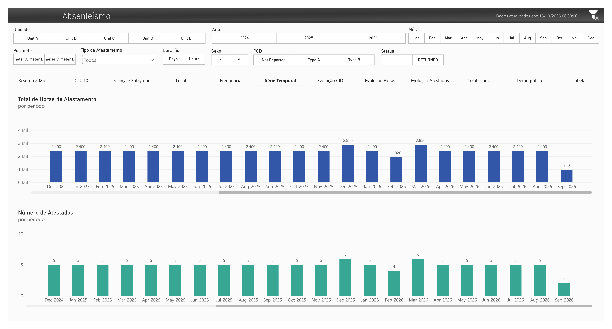

## Purpose

The Time Series page provides a continuous chronological view of absenteeism indicators.

## Main visuals

- monthly total absence hours;
- monthly number of medical certificates.

## Analytical use

This page highlights:

- increases or reductions across consecutive periods;
- changes in duration that are not explained only by certificate volume;
- months requiring additional investigation;
- year-over-year continuity within the selected filter context.

The time axis is supported by `d_calendario` and the active relationship to the absence start date.

---

# 7. Health Group Evolution

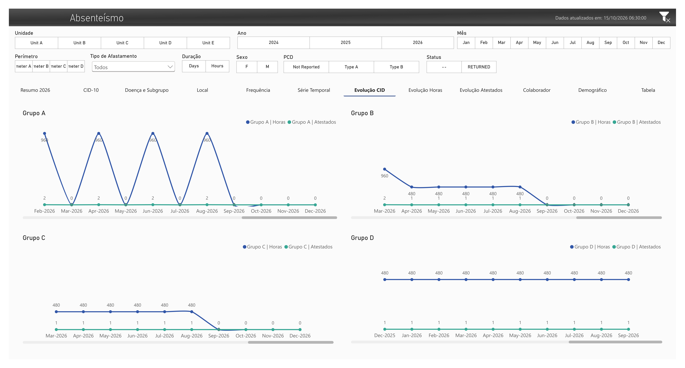

## Purpose

The Health Group Evolution page monitors the monthly behavior of four anonymized health groups: `Health Group A`, `Health Group B`, `Health Group C`, and `Health Group D`.

## Main visuals

Separate visual sections compare hours and certificate counts for:

```text
Group A
Group B
Group C
Group D
```

The public measures use names such as:

```text
Grupo A | Horas
Grupo A | Atestados
Grupo B | Horas
Grupo B | Atestados
Grupo C | Horas
Grupo C | Atestados
Grupo D | Horas
Grupo D | Atestados
```

## Analytical use

This page shows whether each monitored group is:

- stable over time;
- concentrated in specific months;
- increasing in hours but not in certificate count;
- generating isolated or recurring events.

## Privacy note

The correspondence between public groups and the original monitored ICD chapters is intentionally excluded from:

- the PBIX mock data;
- DAX measure names;
- screenshots;
- documentation;
- repository metadata.

---

# 8. Hours Evolution

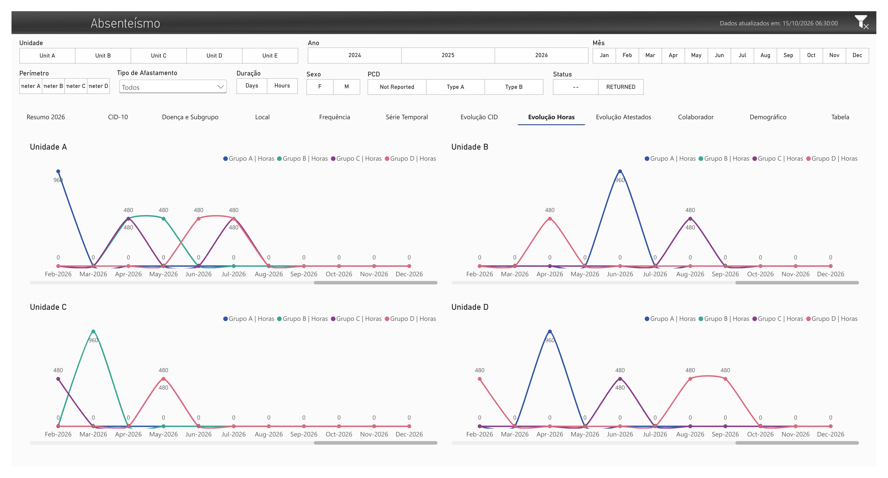

## Purpose

The Hours Evolution page compares the monthly absence-hour contribution of each public health group across anonymized units.

## Main visuals

Unit-specific charts display:

```text
Group A | Hours
Group B | Hours
Group C | Hours
Group D | Hours
```

## Analytical use

The page supports comparison of:

- health-group behavior across units;
- monthly peaks by unit;
- differences in total duration between the monitored groups;
- units with concentrated or recurring hour totals.

The visual layout retains the original dashboard design even though the public mock data contains more unit and perimeter categories.

---

# 9. Certificates Evolution

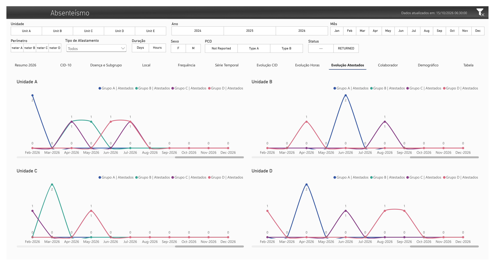

## Purpose

The Certificates Evolution page compares the monthly number of medical certificates for each public health group across anonymized units.

## Main visuals

Unit-specific charts display:

```text
Group A | Certificates
Group B | Certificates
Group C | Certificates
Group D | Certificates
```

## Analytical use

This page complements the Hours Evolution page by distinguishing:

- high-frequency and low-duration patterns;
- low-frequency and high-duration patterns;
- recurring certificates within a unit;
- differences between certificate volume and total absence hours.

---

# 10. Employee Analysis

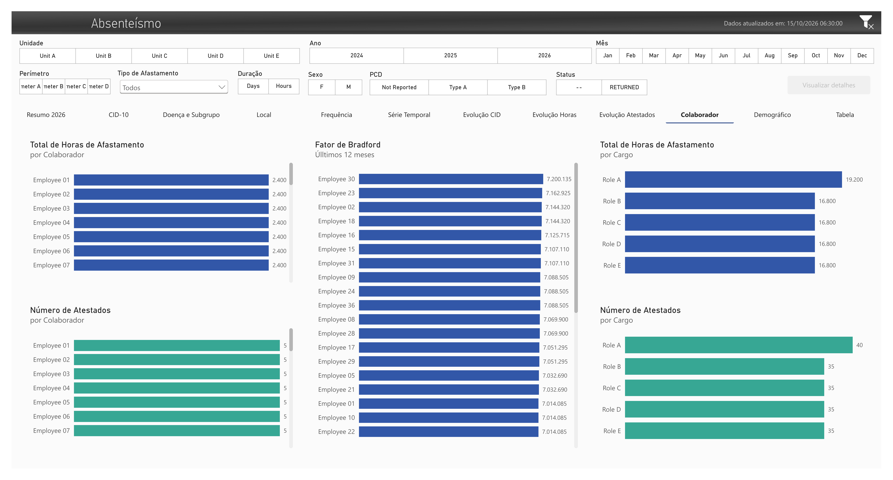

## Purpose

The Employee Analysis page provides an employee-level view using fully synthetic identities.

## Main visuals

- total absence hours by employee;
- total absence hours by generic role;
- number of medical certificates by employee;
- number of medical certificates by generic role;
- Bradford Factor for the latest rolling 12-month period.

## Public identities

Only generic labels are used:

```text
Employee 01
Employee 02
Employee 03
...
```

Generic job labels follow the same approach:

```text
Role A
Role B
Role C
Role D
Role E
```

## Analytical use

The page supports employee-level pattern review without exposing real identities or organization-specific job titles.

The Bradford Factor visual is included as a demonstration of recurring-absence analysis. Values shown in the mock version are synthetic and should not be interpreted as operational results.

---

# 11. Demographics

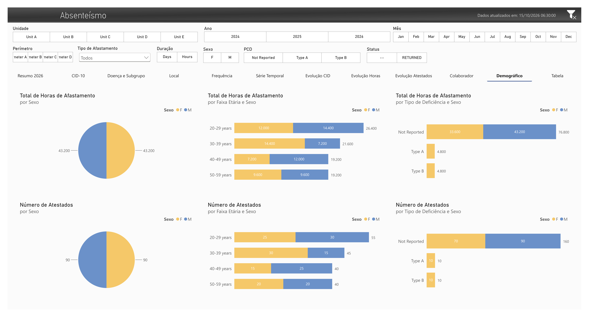

## Purpose

The Demographics page compares absenteeism indicators across synthetic demographic attributes.

## Main visuals

### Gender

- total absence hours by gender;
- number of medical certificates by gender.

### Disability classification

- total absence hours by generic disability type and gender;
- number of medical certificates by generic disability type and gender.

### Age group

- total absence hours by age group and gender;
- number of medical certificates by age group and gender.

## Public classifications

```text
Not Reported
Type A
Type B
```

Age groups include:

```text
20-29 years
30-39 years
40-49 years
50-59 years
```

## Analytical use

The page demonstrates demographic slicing while using synthetic records only. No displayed distribution should be interpreted as representing a real workforce.

---

# 12. Detail Table

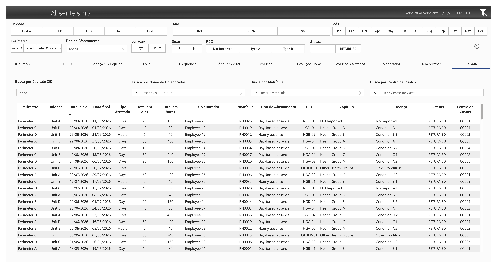

## Purpose

The Detail Table page provides record-level validation and filtered exploration of the synthetic absence dataset.

## Main columns

- perimeter;
- unit;
- start date;
- end date;
- certificate type or duration type;
- total duration in days;
- total duration in hours;
- employee;
- registration;
- leave type;
- health chapter;
- condition;
- status;
- cost center.

## Search and filter controls

The page supports searches by:

- employee name;
- employee registration;
- cost center;
- public health chapter.

## Public values

Example records use values such as:

```text
Employee 26
RH0026
Perimeter B
Unit A
Health Group D
Condition D.1
RETURNED
CC001
```

## Analytical use

This page supports:

- validation of aggregated visuals;
- investigation of selected records;
- comparison of calculated days and hours;
- confirmation of dimensional relationships;
- filtered inspection before exporting or sharing results.

The public table intentionally contains no real employee, organizational, or clinical data.

---

## Common semantic model

The report pages are supported by:

```text
d_calendario
d_cid
d_colab
f_abs
f_cat
Medidas
```

The primary analytical relationships are:

```text
d_calendario[id_data]
    1 -> * f_abs[dt_inicio_afastamento]

d_calendario[id_data]
    1 -> * f_cat[dt_acidente]

d_cid[id_cid]
    1 -> * f_abs[id_cid]

d_colab[id_matricula_rh]
    1 -> * f_abs[id_matricula]

d_colab[id_matricula_rh]
    1 -> * f_cat[id_matricula]
```

Additional model documentation is available in:

```text
power-bi/data-model.md
```

---

## Screenshot and publication notes

- All images must be generated from the mock PBIX.
- The original production report must not be published.
- The public report must not retain original monitored ICD codes in data, DAX, filters, titles, tooltips, or hidden pages.
- Hidden pages, drill-through pages, and tooltip pages must be reviewed before publication.
- The perimeter slicer truncation is accepted because it results from adding more synthetic categories than the original layout supported.
- `Em branco` values may appear where the mock model intentionally preserves unmatched or optional records.
- Synthetic values are designed to demonstrate report behavior, not to reproduce real operational distributions.
