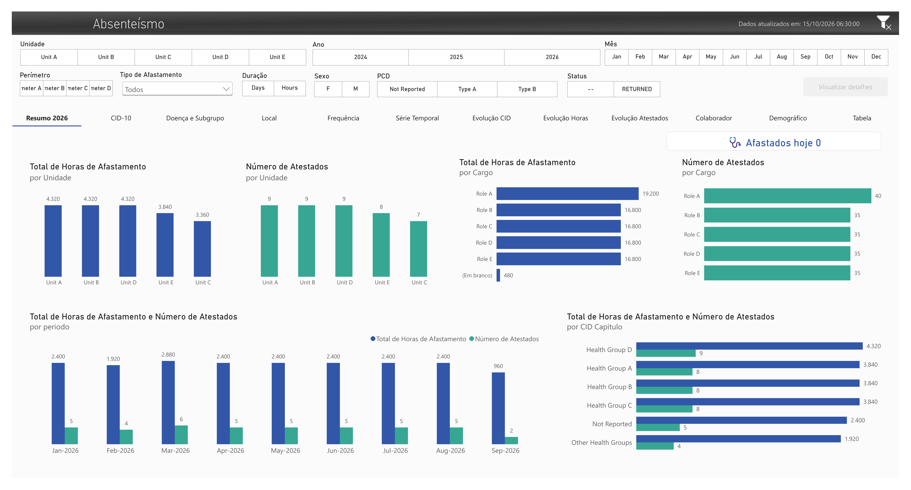
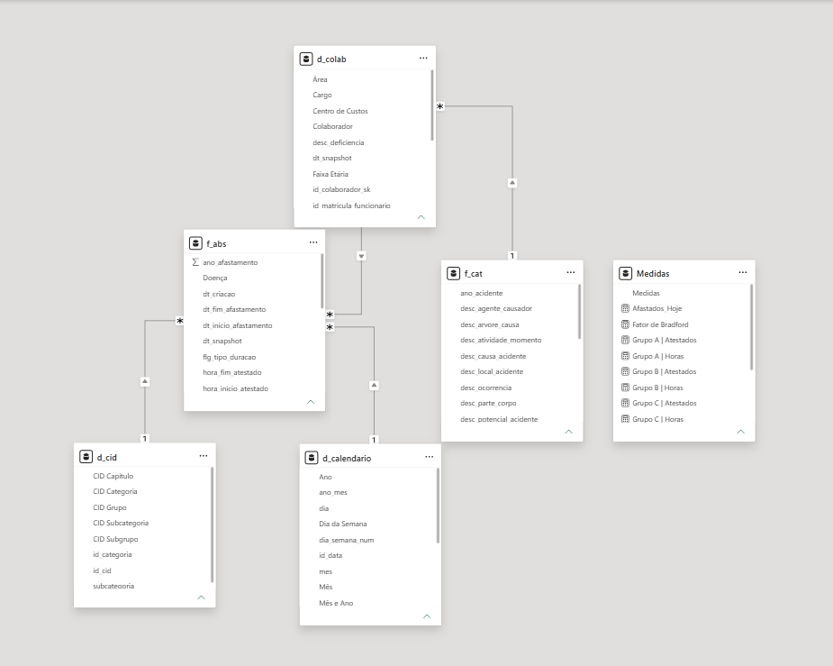

# Dashboard Screenshots

## Overview

This directory contains screenshots of the public, anonymized version of the **Absenteeism Analytics Dashboard**.

The images document the main report pages and the semantic model without requiring access to the Power BI file. All employee names, identifiers, organizational structures, health classifications, monitored groups, and operational values shown in the screenshots must come from the synthetic mock datasets.

> The screenshots are portfolio documentation assets. They do not reproduce production data or disclose the original monitored health groups.

---

## Directory structure

```text
screenshots/
├── README.md
├── 01-overview.png
├── 02-icd-analysis.png
├── 03-disease-subgroup.png
├── 04-location-analysis.png
├── 05-frequency-analysis.png
├── 06-time-series.png
├── 07-health-group-evolution.png
├── 08-hours-evolution.png
├── 09-certificates-evolution.png
├── 10-employee-analysis.png
├── 11-demographics.png
├── 12-detail-table.png
└── 13-data-model.png
```

---

## Screenshot catalog

### `01-overview.png`

Executive overview of absenteeism indicators.

The page summarizes:

- total absence hours;
- number of medical certificates;
- employees currently on leave;
- results by anonymized unit;
- results by generic job role;
- time-based evolution;
- monitored synthetic health groups;
- latest pipeline update.

---

### `02-icd-analysis.png`

Hierarchical analysis of anonymized health classifications.

The page presents:

- synthetic health chapters;
- analytical groups;
- categories and subcategories;
- total absence hours;
- number of medical certificates;
- drill-down across the anonymized hierarchy.

The public report uses labels such as:

```text
Health Group A
Health Group B
Health Group C
Health Group D
Other Health Groups
Not Reported
```

No real ICD chapter, category, subcategory, or monitored code should appear in this image.

---

### `03-disease-subgroup.png`

Analysis by anonymized condition and analytical subgroup.

The page compares:

- generic condition labels;
- synthetic health subgroups;
- absence hours;
- number of medical certificates;
- type of absence.

Example public labels include:

```text
Condition A.1
Condition B.2
Condition C.1
Other condition
Not reported
```

---

### `04-location-analysis.png`

Organizational analysis using fully anonymized structures.

The page presents results by:

- generic cost center;
- anonymized area;
- anonymized unit;
- number of medical certificates;
- total absence hours.

Only generic labels may appear, such as:

```text
Unit A
Area A
Perimeter A
CC001
```

---

### `05-frequency-analysis.png`

Frequency distribution of absence records.

The page includes analysis by:

- day of the week;
- month;
- year;
- number of medical certificates;
- absence hours.

---

### `06-time-series.png`

Time-series analysis of absenteeism indicators.

The page shows:

- monthly evolution of absence hours;
- monthly evolution of medical certificate counts;
- changes over the selected reporting period;
- time filters supported by the calendar dimension.

---

### `07-health-group-evolution.png`

Time-based comparison of the monitored synthetic health groups.

The page uses only public group labels:

```text
Group A
Group B
Group C
Group D
```

The original health-group correspondence must not be documented in the repository, image metadata, alternative text, measure names, or visible report elements.

---

### `08-hours-evolution.png`

Evolution of absence hours across synthetic health groups and anonymized units.

The page supports comparison of:

- total hours;
- reporting periods;
- anonymized units;
- monitored public health groups.

---

### `09-certificates-evolution.png`

Evolution of medical certificate counts across synthetic health groups and anonymized units.

The page supports comparison of:

- number of certificates;
- reporting periods;
- anonymized units;
- monitored public health groups.

---

### `10-employee-analysis.png`

Employee-level analysis based entirely on synthetic identities.

The page includes:

- generic employee labels;
- generic job roles;
- medical certificate counts;
- total absence hours;
- Bradford Factor analysis for the selected period.

Only labels such as `Employee 01`, `Employee 02`, and similar synthetic names may appear.

---

### `11-demographics.png`

Demographic analysis of the synthetic employee population.

The page presents results by:

- gender;
- age group;
- generic disability classification;
- total absence hours;
- number of medical certificates.

The screenshot must not contain real demographic, disability, or medical information.

---

### `12-detail-table.png`

Detailed analytical table for the synthetic absence records.

The page may include:

- employee label;
- synthetic registration;
- generic cost center;
- organizational unit;
- synthetic health group;
- start and end dates;
- absence duration;
- current status;
- source classification.

Any search fields, filters, tooltips, drill-through content, and table exports shown in the image must also use synthetic values.

---

### `13-data-model.png`

Semantic-model view of the Power BI dataset.

The image should show these tables:

```text
d_calendario
d_cid
d_colab
f_abs
f_cat
Medidas
```

Expected public relationships:

```text
d_calendario[id_data]
    1 -> * f_abs[dt_inicio_afastamento]

d_calendario[id_data]
    1 -> * f_cat[dt_acidente]

d_cid[id_cid]
    1 -> * f_abs[id_cid]

d_colab[id_matricula_rh]
    1 -> * f_abs[id_matricula]

d_colab[id_matricula_rh]
    1 -> * f_cat[id_matricula]
```

Filter direction should normally flow from each dimension to the related fact table.

Measure names visible in this screenshot must use generic public names, such as:

```text
Group A | Certificates
Group A | Hours
Group B | Certificates
Group B | Hours
Group C | Certificates
Group C | Hours
Group D | Certificates
Group D | Hours
```

The image must not display the original monitored ICD chapter letters or descriptions.

---

## Screenshot requirements

All screenshots should follow the same publication standard:

- use the mock Power BI datasets;
- capture the full report canvas;
- use a consistent browser or application zoom;
- avoid visible desktop notifications or operating-system elements;
- exclude the Power BI account name and workspace name;
- exclude refresh credentials and connection dialogs;
- exclude file-system paths and internal data-source names;
- remove selection borders unless they help explain the visual;
- ensure titles, legends, slicers, and axis labels remain readable;
- use PNG format;
- avoid unnecessary compression;
- preserve a consistent aspect ratio where possible.

---

## Anonymization checklist

Before committing a screenshot, confirm that the image does not expose:

- real employee names;
- real employee registrations;
- real tax identifiers;
- real units or locations;
- real departments, areas, or perimeters;
- real job titles if they are organization-specific;
- real ICD codes;
- original monitored ICD chapters;
- real diagnosis descriptions;
- medical notes or free-text observations;
- internal database, catalog, or schema names;
- source-system URLs;
- workspace, tenant, or cluster identifiers;
- user names or email addresses.

The public screenshots should use values such as:

```text
Employee 01
RH0001
SYNTH00000000001
Unit A
Area A
Perimeter A
Role A
Health Group A
Condition A.1
```

---

## Truncated slicer labels

Some slicer labels may appear truncated because the mock dataset contains more synthetic categories than the original report layout was designed to display.

For example, the public perimeter slicer contains:

```text
Perimeter A
Perimeter B
Perimeter C
Perimeter D
```

The original layout was designed for fewer perimeter values. This visual truncation does not affect filtering behavior or analytical results and is intentionally retained to preserve the original dashboard layout.

---

## Usage in documentation

The images in this directory are referenced by the Power BI documentation.

From `power-bi/dashboard-pages.md`, use paths relative to the `power-bi/` directory:

```markdown

```

From the repository root README, use:

```markdown

```

From `power-bi/data-model.md`, use:

```markdown

```

---

## Naming convention

Screenshot names follow this pattern:

```text
NN-short-page-description.png
```

Where:

- `NN` preserves the report-page order;
- filenames use lowercase letters;
- words are separated with hyphens;
- names describe the page purpose rather than internal labels.

---

## Publication scope

These images document the public mock report only. Screenshots from the production report, internal workspace, refresh history, gateway configuration, credentials, or deployment pipeline must not be committed to this repository.
